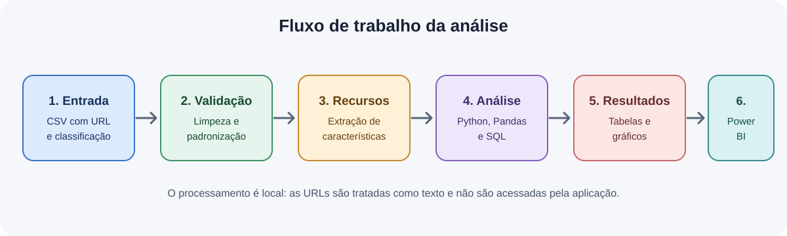

# Análise de URLs: identificação de padrões associados a phishing

Projeto de análise de dados desenvolvido com **Python, Pandas, NumPy, SQL e Power BI** para investigar características estruturais de URLs classificadas como legítimas ou associadas a phishing.

> **Aviso metodológico:** a base incluída neste repositório é pequena e sintética, criada exclusivamente para demonstrar o funcionamento do pipeline. Ela não representa uma amostra real da internet e não permite medir a eficácia de um detector. As características analisadas são indicadores exploratórios, não provas de que uma URL é maliciosa.

## Visão geral do processo\n\n\n\n## Objetivos

- Preparar e validar dados tabulares de URLs.
- Extrair características estruturais sem abrir ou acessar os endereços.
- Comparar padrões entre os rótulos legítimo e phishing.
- Armazenar os dados tratados em CSV e SQLite.
- Produzir indicadores e gráficos para apoiar uma análise exploratória.
- Disponibilizar uma estrutura que possa ser conectada ao Power BI.

## Tecnologias

| Tecnologia | Aplicação |
|---|---|
| Python | Organização e execução do pipeline |
| Pandas | Leitura, limpeza e transformação dos dados |
| NumPy | Operações numéricas e tratamento de valores ausentes |
| SQL / SQLite | Consultas e agregações analíticas |
| Matplotlib | Geração de gráficos |
| Power BI | Construção de dashboard a partir dos arquivos exportados |

## Estrutura do projeto

```text
analise_url_fishing/
├── data/
│   ├── raw/
│   │   └── urls_exemplo.csv
│   ├── processed/
│   └── README.md
├── docs/
│   ├── metodologia.md
│   └── power_bi.md
├── images/
│   └── fluxo_projeto.svg
├── reports/
│   └── figures/
├── sql/
│   └── analises.sql
├── src/
│   ├── __init__.py
│   ├── features.py
│   └── pipeline.py
├── .gitignore
├── main.py
└── requirements.txt
```

## Como executar

### 1. Pré-requisitos

- Python 3.10 ou superior.
- Git (opcional, para clonar o repositório).
- Power BI Desktop (opcional, para montar o dashboard).

### 2. Baixar o projeto e instalar dependências

```bash
git clone https://github.com/alvesrejoelias-ops/analise_url_fishing.git
cd analise_url_fishing
python -m venv .venv
```

No Windows:

```powershell
.venv\Scripts\activate
pip install -r requirements.txt
```

### 3. Executar a análise

```bash
python main.py
```

O programa lê `data/raw/urls_exemplo.csv` e gera:

- `data/processed/urls_analisadas.csv`: base tratada e enriquecida com características.
- `data/processed/analise_urls.db`: banco SQLite com a tabela `urls_analysis`.
- `reports/resumo_por_classe.csv`: indicadores agrupados por classificação.
- `reports/figures/distribuicao_classes.png`: distribuição dos registros por classe.
- `reports/figures/comprimento_urls.png`: comparação do comprimento das URLs.
- `reports/figures/indicadores_estruturais.png`: comparação de características estruturais.

## Campos analisados

| Campo | Descrição |
|---|---|
| `url_length` | Quantidade de caracteres da URL |
| `dot_count` | Quantidade de pontos |
| `hyphen_count` | Quantidade de hífens |
| `digit_count` | Quantidade de dígitos |
| `has_https` | Indica se o esquema informado é HTTPS |
| `has_ip_address` | Indica se o host é um endereço IP |
| `has_at_symbol` | Indica a presença do caractere @ |
| `subdomain_count` | Quantidade aproximada de subdomínios |
| `query_parameter_count` | Quantidade de parâmetros na query string |
| `has_suspicious_keyword` | Indica a presença de termos selecionados para triagem |

**Redirecionamentos:** não são medidos neste projeto porque isso exigiria acessar os endereços. O pipeline não realiza requisições HTTP nem segue links. Se uma base confiável fornecer uma coluna `redirect_count`, ela poderá ser incorporada em uma etapa futura, com documentação da origem.

## Consultas SQL

As consultas estão em `sql/analises.sql`. Elas demonstram contagem por classe, médias de características e comparação de indicadores. O banco SQLite é criado automaticamente ao executar o pipeline.

## Power BI

Siga as instruções em [docs/power_bi.md](docs/power_bi.md) para importar o CSV tratado e criar indicadores e visuais.

## Limitações e responsabilidade

- O conjunto de exemplo é sintético e serve apenas para validar o fluxo técnico.
- Uma URL com HTTPS, domínio longo ou palavras específicas não é necessariamente fraudulenta.
- A ausência desses sinais não garante segurança.
- Nenhuma URL é acessada, testada ou aberta pelo código.
- Não utilize este projeto como ferramenta de bloqueio, decisão de segurança ou classificação operacional.

Leia [docs/metodologia.md](docs/metodologia.md) para conhecer as decisões de tratamento e as limitações da análise.

## Próximas melhorias

1. Substituir a base demonstrativa por uma fonte pública, documentada e licenciada.
2. Aumentar a amostra e avaliar o equilíbrio entre as classes.
3. Incluir validação de qualidade dos dados e testes automatizados.
4. Incorporar dados de redirecionamento somente quando fornecidos por uma fonte confiável.
5. Desenvolver um dashboard no Power BI com filtros por classe e indicadores.

---
Projeto educacional de análise de dados.